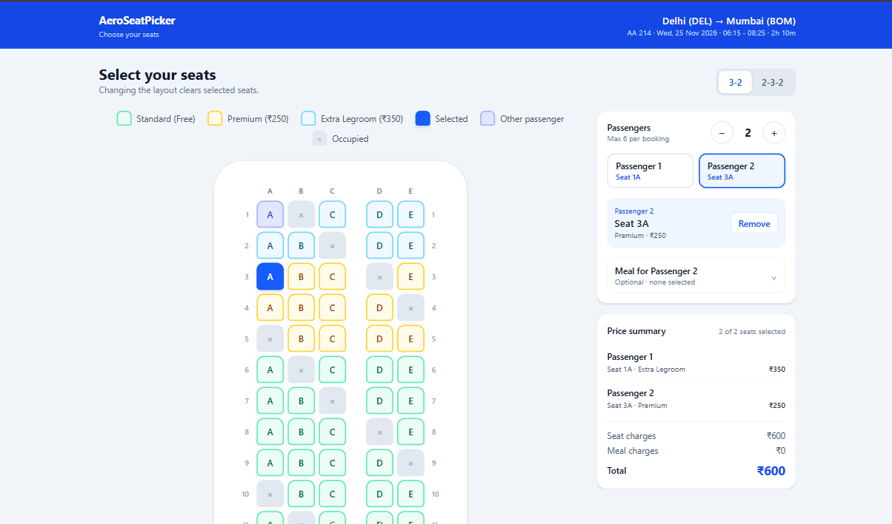
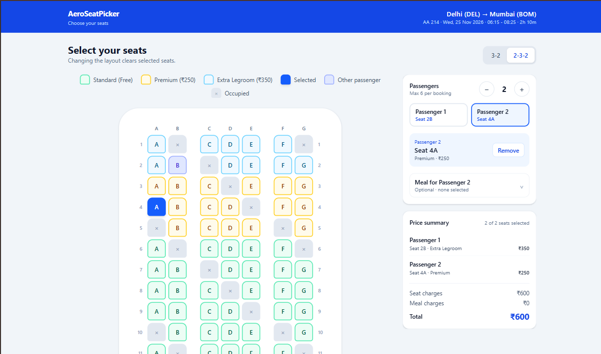
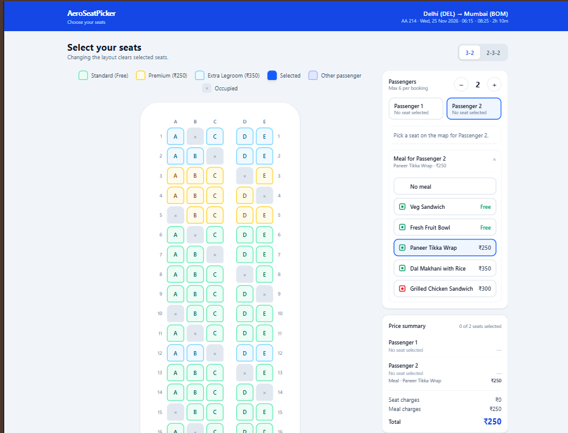
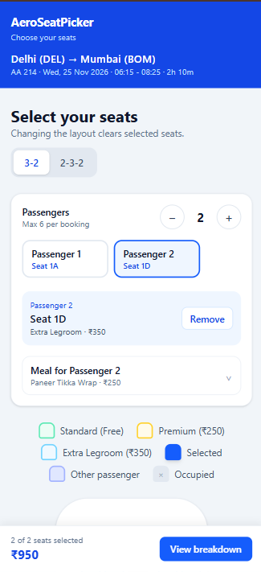

# AeroSeatPicker

Flight seat selection and passenger management UI built with React. Choose the number of passengers, switch between two aircraft layouts, assign a seat to each passenger, add an optional meal, and see the price breakdown update instantly.

**Live demo:** [aeroseatpicker.vercel.app](https://aeroseatpicker.vercel.app/)

## Screenshots







## Features

- Select 1 to 6 passengers and switch between them using tabs. Each tab shows the passenger's assigned seat.
- Two aircraft layouts: 3-2 (100 seats) and 2-3-2 (140 seats), 20 rows each, with row numbers and seat labels.
- Clear seat states: available, occupied, selected (active passenger), and assigned to another passenger.
- Three price categories shown with colours and a legend: Standard (free), Premium (₹250) and Extra Legroom (₹350).
- Assign, change or remove a seat. Seat assignments are kept when switching passengers.
- Invalid actions (occupied seat, seat taken by another passenger) give toast feedback.
- Price summary with a per-passenger breakdown, seat charges, meal charges and total. A sticky total bar is shown on mobile.
- Bonus: one optional meal per passenger with five options (two free, three paid). Meal charges are included in the total.
- Loading skeleton, error state with retry, and empty state for the seat map.
- Responsive layout from 360px phones to desktop.

## Tech stack

- React and Vite
- Tailwind CSS v4 (`@tailwindcss/vite`)
- State management with Context API and `useReducer`
- Mock data only, no backend
- Deployed on Vercel

## Getting started

```bash
git clone https://github.com/Pankaj2004s/aeroseatpicker.git
cd aeroseatpicker
npm install
npm run dev
```

The app runs on http://localhost:5173 by default.

Other scripts: `npm run build` creates a production build, `npm run preview` serves it locally, and `npm run lint` runs ESLint.

To see the error and empty states, open the app with a query parameter:

- `/?simulate=error` makes the seat map fail to load (a retry button is shown).
- `/?simulate=empty` returns a flight with no seats.

## How it works

Design decisions:

- **`useReducer` instead of several `useState` calls.** Many changes touch more than one part of the state. For example, changing the layout clears assignments, and reducing the passenger count removes the extra passengers' seats and meals and may change the active passenger. A reducer performs each of these as one update, and it is a pure function, so it can be tested without React.
- **Maps keyed by passenger.** `assignments` and `meals` are objects keyed by passenger id, so one passenger can hold only one seat and one meal by structure.
- **Derived data is not stored.** Seat rows come from the layout, seat status (available, occupied, selected, assigned) is computed from `assignments`, and charges and totals are computed from `assignments`, `meals` and seat data. Because there is one source of truth, the total cannot go out of sync with the selection.
- **Context API instead of Redux.** The state is small and used by one feature, so Context with a reducer is enough and adds no dependency.

### Seat assignment logic

When a seat is clicked, `SeatMap` decides what to do in this order:

1. The seat is occupied: show an error toast, change nothing.
2. The seat already belongs to the active passenger: remove it.
3. The seat belongs to another passenger: show an error toast, change nothing.
4. Otherwise assign the seat to the active passenger. If that passenger already had a seat, the old seat becomes free (the passenger is moved).

The reducer enforces the rules again: `ASSIGN_SEAT` is ignored if another passenger already holds the seat. This means the state stays valid even if another component dispatches the action. The UI gives the user feedback, and the reducer protects the data.

### Pricing

Pure functions in `src/utils/pricing.js` build a charge for each passenger (seat price, meal price, total) and then sum seat, meal and grand totals. `usePricing()` memoizes the result and is used by both the price summary and the mobile total bar. Prices are whole rupees, so there are no floating-point issues.

### Loading, error and empty states

`useSeatRows(layoutId)` loads the seat rows from the mock service. It ignores stale responses (an effect cleanup flag), so switching layouts quickly never shows the wrong map. The loading status is derived by comparing a request key, which avoids setting state synchronously inside an effect. `SeatMap` renders a skeleton, an error card with a retry button, or an empty state.

## Project structure

```
src/
  components/   Seat, SeatRow, SeatMap, PassengerTabs, MealSelector, PriceSummary, ...
  context/      seatReducer.js, SeatContext.js, SeatProvider.jsx
  data/         layouts, seat categories, meals, flight details, seat generator, mock service
  hooks/        useSeats, usePricing, useSeatRows, useToast
  utils/        formatPrice, pricing
```
